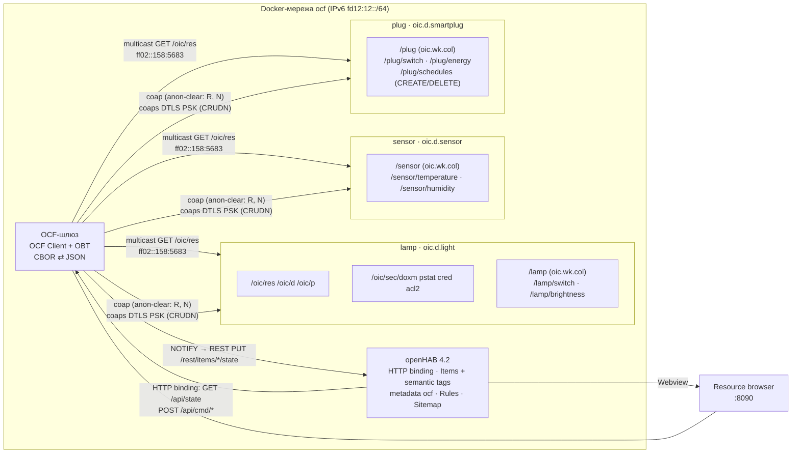
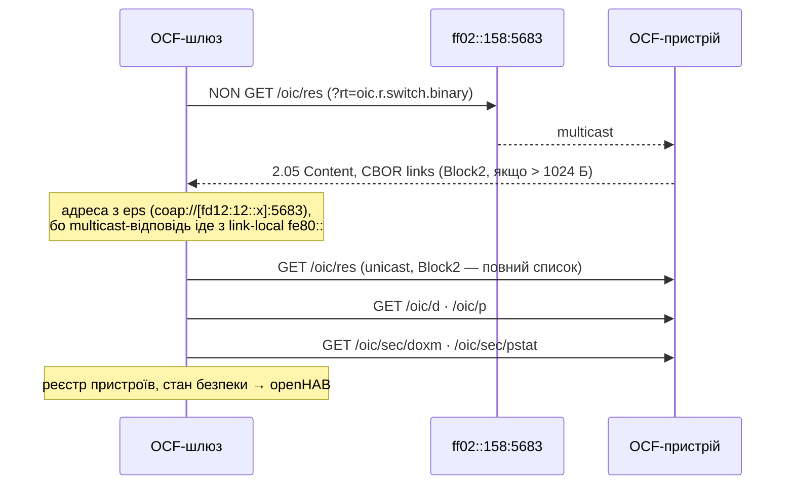
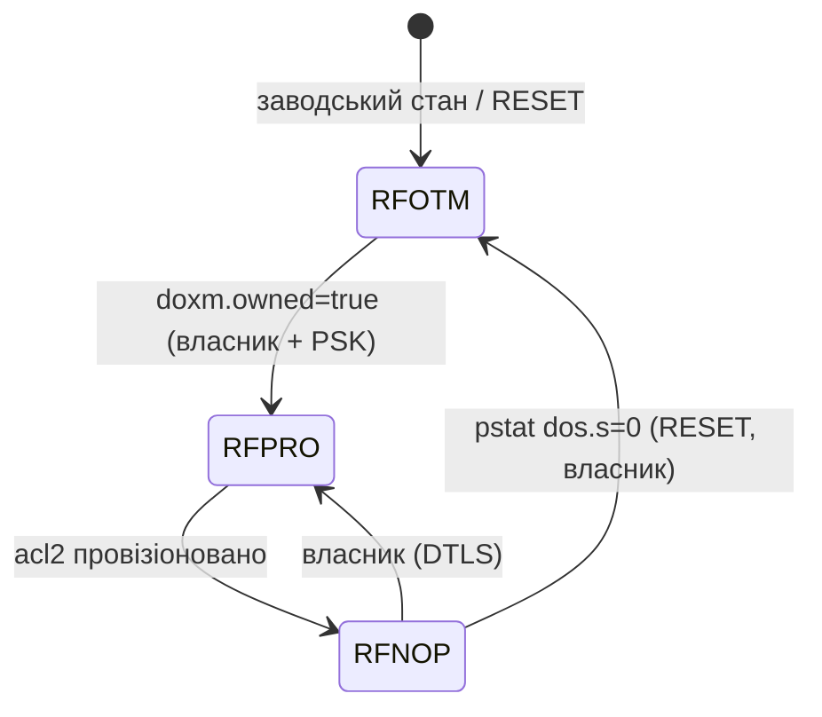

# IOTPRP12 — OCF Standard Integration з openHAB

Практична робота 12.2, **варіант 5: OCF Standard Integration** — OCF-сумісна система з CRUDN-операціями, discovery та безпекою.

| Компонент | Технологія | Адреса |
|---|---|---|
| 3 OCF-пристрої (`lamp`, `sensor`, `plug`) | Python, aiocoap, CBOR, tinydtls | `coap://[ipv6]:5683`, `coaps://[ipv6]:5684`, multicast `ff02::158` |
| OCF-шлюз (OCF Client + Onboarding Tool) | aiocoap + aiohttp | <http://localhost:8090> (HTTP API + resource browser) |
| openHAB 4.2.2 | HTTP binding, JSONPath, MAP, RRD4j, DSL rules | <http://localhost:8085/basicui/app?sitemap=ocf> |

## Запуск

```bash
docker compose up -d --build
```

Перший запуск збирає tinydtls (1–2 хв) та встановлює доповнення openHAB. Потім:

```bash
bash scripts/check.sh      # discovery, onboarding, усі CRUDN-операції, помилки доступу
```

> Мережа Docker створюється з IPv6 (`fd12:12::/64`): OCF discovery працює через IPv6 multicast `ff02::158` (All OCF Nodes).

## OCF architecture overview



OCF Core: кожен пристрій — це набір **ресурсів** (URI + `rt` resource type + `if` інтерфейси + властивості). Обов'язкові ресурси `/oic/res`, `/oic/d`, `/oic/p` і ресурси безпеки `/oic/sec/*`. Представлення кодується в **CBOR** (`application/vnd.ocf+cbor`, content-format 10000); на запит з `Accept: 50` пристрій віддає JSON.

## Resource type catalog

| href | rt | Інтерфейси | Властивості | Операції |
|---|---|---|---|---|
| `/oic/res` | `oic.wk.res` | `oic.if.ll`, `oic.if.baseline` | масив links: `anchor`, `href`, `rt`, `if`, `p.bm`, `eps` | R (unicast і multicast), фільтри `?rt=`, `?if=` |
| `/oic/d` | `oic.wk.d` + `oic.d.light`/`oic.d.sensor`/`oic.d.smartplug` | `oic.if.r`, `oic.if.baseline` | `n`, `di`, `piid`, `icv`, `dmv`, `dmno`, `dmn` | R |
| `/oic/p` | `oic.wk.p` | `oic.if.r`, `oic.if.baseline` | `pi`, `mnmn`, `mnml`, `mnmo`, `mndt`, `mnpv`, `mnos`, `mnhw`, `mnfv`, `st` | R |
| `/oic/sec/doxm` | `oic.r.doxm` | `oic.if.baseline` | `oxms`, `oxmsel`, `sct`, `owned`, `deviceuuid`, `devowneruuid`, `rowneruuid` | R, U |
| `/oic/sec/pstat` | `oic.r.pstat` | `oic.if.baseline` | `dos.s` (RESET/RFOTM/RFPRO/RFNOP), `isop`, `cm`, `tm`, `om`, `sm` | R, U |
| `/oic/sec/cred` | `oic.r.cred` | `oic.if.baseline` | `creds[]`: `subjectuuid`, `credtype`, `privatedata` (не віддається) | R, U |
| `/oic/sec/acl2` | `oic.r.acl2` | `oic.if.baseline` | `aclist2[]`: `subject`, `resources`, `permission` (CRUDN-біти) | R, U |
| `/lamp/switch`, `/plug/switch` | `oic.r.switch.binary` | `oic.if.a`, `oic.if.baseline` | `value: boolean` | R, U, N |
| `/lamp/brightness` | `oic.r.light.brightness` | `oic.if.a`, `oic.if.baseline` | `brightness: 0..100` | R, U, N |
| `/sensor/temperature` | `oic.r.temperature` | `oic.if.s`, `oic.if.baseline` | `temperature`, `units: "C"`, `range` | R, N (U → 4.05) |
| `/sensor/humidity` | `oic.r.humidity` | `oic.if.s`, `oic.if.baseline` | `humidity` | R, N |
| `/plug/energy` | `oic.r.energy.consumption` | `oic.if.s`, `oic.if.baseline` | `power` (W), `energy` (Wh) | R, N |
| `/lamp`, `/sensor`, `/plug` | `oic.wk.col` | `oic.if.ll`, `oic.if.b`, `oic.if.baseline` | `links` | R (batch), U (batch) |
| `/plug/schedules` | `oic.wk.col`, `x.org.iotprp12.schedules` | `oic.if.ll`, `oic.if.create`, `oic.if.baseline` | `links` | R, **C** |
| `/plug/schedules/{n}` | `x.org.iotprp12.schedule` (вендорний `x.`-тип) | `oic.if.rw`, `oic.if.baseline` | `at: "HH:MM"`, `value`, `enabled` | R, U, **D** |

## CRUDN

| Операція OCF | CoAP | Приклад | Відповідь |
|---|---|---|---|
| **C**reate | `POST <collection>?if=oic.if.create` | `/plug/schedules` + `{rt, rep:{at, value}}` | `2.01 Created`, `Location-Path: /plug/schedules/1` |
| **R**etrieve | `GET <href>?if=<interface>` | `/lamp/switch?if=oic.if.baseline` | `2.05 Content` (CBOR) |
| **U**pdate | `POST <href>` (часткове оновлення) | `/lamp/brightness` + `{brightness: 40}` | `2.04 Changed` |
| **D**elete | `DELETE <href>` | `/plug/schedules/1` | `2.02 Deleted` |
| **N**otify | `GET <href>` + `Observe: 0` | `/sensor/temperature` | серія `2.05` при кожній зміні |
| Batch | `GET/POST <collection>?if=oic.if.b` | `/lamp` + `[{href, rep}, …]` | атомарно: спочатку перевірка всіх, потім застосування |

Помилки: `4.00` невалідне значення / непідтримуваний інтерфейс, `4.01` немає прав (анонімний доступ або пристрій не провізіонований), `4.04` немає ресурсу, `4.05` запис у read-only (`oic.if.s`).

## Discovery flow



* **Device discovery** `/oic/res`: кожен link має `anchor: ocf://<di>`, бітмаску `p.bm` (1 — discoverable, 2 — observable) і `eps` з `coap://` та `coaps://` endpoint.
* **Platform discovery** `/oic/p` та **device info** `/oic/d` — після discovery.
* **Фільтрація за типом**: `GET /oic/res?rt=<type>` — пристрої без збігів не повертають посилань.
* Шлюз повторює discovery кожну хвилину; openHAB — кожні 2 хв і за кнопкою; нові пристрої і зміни IP підхоплюються автоматично.

## Security model



**Onboarding / ownership transfer** (Just Works, `oxm 0`), виконує шлюз як Onboarding Tool з `uuid 482fb146-…`:

| Крок | Запит | Канал |
|---|---|---|
| 1 | `GET /oic/sec/doxm` → `owned=false`, `oxms=[0]` | coap |
| 2 | `POST doxm {oxmsel: 0}` | coap (RFOTM) |
| 3 | `POST doxm {devowneruuid, rowneruuid}` | coap (RFOTM) |
| 4 | `POST cred {subjectuuid: OBT, credtype: 1, privatedata: PSK 128 біт}` | coap (RFOTM) |
| 5 | `POST doxm {owned: true}` | coap (RFOTM) |
| 6 | `POST pstat {dos.s: 2}` — **перша DTLS-сесія з PSK** | coaps |
| 7 | `POST acl2 {aclist2}` | coaps |
| 8 | `POST pstat {dos.s: 3}` → `isop=true` | coaps |

**Access control** (`oic.r.acl2`):

| ACE | subject | resources | permission |
|---|---|---|---|
| 1 | `conntype: anon-clear` | `wc: "+"` (усі discoverable) | R + N (`18`) |
| 2 | `uuid: <OBT>` | `wc: "*"` | C+R+U+D+N (`31`) |

* До RFNOP прикладні ресурси закриті (`4.01 … onboarding required`).
* У RFNOP анонімний coap-клієнт може лише читати й спостерігати; Update/Create/Delete — тільки власник через DTLS (`4.01 … use coaps`).
* Після `owned=true` ресурси `/oic/sec/*` змінює лише власник по DTLS; приватний ключ з `/oic/sec/cred` назовні не віддається.
* **Secure communication**: DTLS 1.2 PSK (tinydtls, `TLS_PSK_WITH_AES_128_CCM_8`), identity = uuid власника (32 hex-символи), пристрій бачить автентифікованого клієнта як claim `:<uuid>`. PSK зберігаються в томі `obt_data` шлюзу.
* Спрощення відносно OCF Security 2.x: Just Works у реальних пристроях виконується в анонімній ECDH-DTLS-сесії, тут кроки 1–5 ідуть по coap у стані RFOTM; сертифікатні методи (`oxm 2`, manufacturer certificate) не реалізовані.

## openHAB

### Семантична модель і метадані

`Дім (Location)` → `Вітальня`/`Кухня` → `Equipment` (`Lightbulb`, `Sensor`, `PowerOutlet`) → `Point` (`Switch`/`Control`/`Measurement`/`Status` + `Light`/`Temperature`/`Humidity`/`Power`/`Energy`).

Кожен item має метадані простору імен `ocf`, що зв'язують його з OCF Resource Model ([`ocf.items`](openhab/conf/items/ocf.items)):

```
Dimmer Lamp_Brightness "Лампа: яскравість [%d %%]" (eLamp) ["Control", "Light"]
    { channel="http:url:ocf:lamp_brightness",
      ocf="oic.r.light.brightness" [ href="/lamp/brightness", prop="brightness", if="oic.if.a", type="integer", min="0", max="100", ops="RUN" ] }
```

### HTTP binding ("HTTP simulation" CoAP binding)

[`ocf.things`](openhab/conf/things/ocf.things): один `http:url` Thing опитує `GET /api/state` (JSONPath-трансформації для кожного каналу) і надсилає команди `POST /api/cmd/<key>`. Шлюз перетворює команду на `UPDATE` (CoAP POST по coaps). Зміни від пристроїв (OCF NOTIFY) шлюз одразу публікує в items через REST — без чекання опитування.

### Rules ([`ocf.rules`](openhab/conf/rules/ocf.rules))

| Правило | Що робить |
|---|---|
| Періодичний discovery | multicast `/oic/res` кожні 2 хв і при старті |
| Discovery за кнопкою / фільтр `rt` | `POST /api/discover[?rt=]` |
| Onboarding / RESET | `POST /api/onboard/all`, `POST /api/reset/lamp` |
| CREATE / DELETE розкладу | `POST` / `DELETE /api/schedule` |
| Перевірка безпеки | `OCF_SecAlert`: попередження, якщо пристрій не в RFNOP |
| Новий пристрій | лог зміни кількості пристроїв |

### Resource browser UI

* Sitemap `ocf`: пристрої, discovery (фільтр `rt`), безпека (`doxm`/`pstat`), CRUDN, тренди NOTIFY → RRD4j і вбудований через `Webview` resource browser шлюзу.
* <http://localhost:8090/>: картки пристроїв (`/oic/d`, `/oic/p`, стан безпеки, Onboarding/RESET), таблиця ресурсів з `rt`/`if`, вибір інтерфейсу та кнопки **C R U D**, журнал discovery/onboarding/CRUDN/NOTIFY наживо (SSE).

## HTTP API шлюзу

| Метод | Шлях | Опис |
|---|---|---|
| `POST` | `/api/discover[?rt=<type>]` | multicast discovery |
| `GET` | `/api/devices` | реєстр: `/oic/d`, `/oic/p`, `doxm`, `pstat`, links, останні значення |
| `GET` | `/api/resources[?rt=&if=&device=&format=text]` | пошук ресурсів у реєстрі |
| `POST` | `/api/onboard/{name\|all}` | ownership transfer + provisioning |
| `POST` | `/api/reset/{name}` | `pstat dos.s=0` |
| `GET` | `/api/res/{name}/{href}?if=&secure=0\|1` | RETRIEVE |
| `POST` | `/api/res/{name}/{href}[?if=oic.if.b]` | UPDATE / batch UPDATE (JSON → CBOR) |
| `PUT` | `/api/res/{name}/{collection}` | CREATE (`?if=oic.if.create`) |
| `DELETE` | `/api/res/{name}/{href}` | DELETE |
| `GET` | `/api/state` | агрегований стан для HTTP binding |
| `POST` | `/api/cmd/{lamp_switch\|lamp_brightness\|plug_switch}` | команда з openHAB |
| `POST`/`DELETE` | `/api/schedule` | CREATE / DELETE розкладу розетки |
| `GET` | `/api/events` | SSE-журнал подій |

Відповідь CRUDN-запиту містить код CoAP, схему (`coap`/`coaps`), content-format, розмір CBOR і представлення.

## Перевірені сценарії

| # | Сценарій | Результат |
|---|---|---|
| 1 | Multicast discovery | 3 пристрої, `/oic/res` 1.5–1.7 КБ (Block2) |
| 2 | Discovery `?rt=oic.r.switch.binary` | відповіли лише `lamp` і `plug` |
| 3 | RETRIEVE до onboarding | `4.01 device not provisioned (RFOTM)` |
| 4 | Onboarding усіх | 8 кроків, RFNOP, DTLS-сесія, Observe |
| 5 | Анонімний RETRIEVE / UPDATE по coap | `2.05` / `4.01 use coaps` |
| 6 | UPDATE по coaps, поза діапазоном, read-only, невідомий інтерфейс | `2.04` / `4.00` / `4.05` / `4.00` |
| 7 | Batch RETRIEVE та UPDATE `/lamp?if=oic.if.b` | `2.05` / `2.04` |
| 8 | CREATE і DELETE розкладу | `2.01` + Location-Path / `2.02` |
| 9 | openHAB → пристрій (`Lamp_Brightness` = 85) | значення на пристрої за ~1 с |
| 10 | RESET лампи з sitemap → команда | `4.01`; повторний onboarding — знову RFNOP |

## Структура

```
IOTPRP12/
├── docker-compose.yml          # 3 OCF-пристрої, шлюз, openHAB; IPv6-мережа
├── ocf-device/ocf_device.py    # OCF resource model, discovery, CRUDN, security (doxm/pstat/cred/acl2), DTLS
├── ocf-gateway/
│   ├── ocf_gateway.py          # discovery, OBT (onboarding), CRUDN, observe, HTTP API
│   └── ui.html                 # resource browser
├── openhab/conf/
│   ├── things/ocf.things       # HTTP binding
│   ├── items/ocf.items         # semantic model + metadata ocf
│   ├── rules/ocf.rules         # discovery, onboarding, CRUDN, security check
│   ├── sitemaps/ocf.sitemap    # resource browser UI
│   └── persistence, services
├── scripts/check.sh            # автоматична перевірка
└── video/                      # демо-відео
```

## Demo video

[`video/IOTPRP12.mp4`](video/IOTPRP12.mp4) — 2:48, з озвученням. Показано: архітектуру й каталог ресурсів, multicast discovery у resource browser, відмову `4.01` до onboarding, onboarding (8 кроків, DTLS PSK), CRUDN (Retrieve з `oic.if.baseline`, Update, Create `2.01`, Delete `2.02`), перевірки доступу та batch, керування з sitemap openHAB, фільтр discovery за `rt`, RESET і повторний onboarding, CREATE/DELETE через правила, NOTIFY і тренди.

Перезапис:

```bash
bash video/record.sh        # Playwright у мережі стека -> video/out/IOTPRP12-demo.webm + scenes.json
```

Текст озвучки — [`video/voiceover/tekst_tts.md`](video/voiceover/tekst_tts.md), генерація — [`generate_prp12.py`](video/voiceover/generate_prp12.py) (OmniVoice), прибирання вдихів і збірка доріжки — [`clean_breaths.py`](video/voiceover/clean_breaths.py) (`--skip-before 8 --total 168`), зведення з обрізкою перших 8 с — [`video/mux_prp12.py`](video/mux_prp12.py).

## 🤖 Декларація використання ШІ

* **Інструмент:** ChatGPT (Codex).
* **Мета використання:** допомога з упорядкуванням README, стислим описом структури проєкту, інтерфейсу Basic UI та результатів, уже наведених у журналах і знімках екрана.
* **Текстовий запит:** знайти папку IOTPRP12, підготувати README з описом проєкту та декларацією використання ШІ й завантажити матеріали до вказаного GitHub-репозиторію.
* **Фрагменти згенерованого контенту:** за допомогою ChatGPT сформульовано та відредаговано окремі текстові фрагменти цього README, зокрема опис інтерфейсу й результатів перевірок. ChatGPT також допомагав налагоджувати помилки в коді, виявлені під час перевірки на аномалії.
* **Власне доопрацювання та перевірка:**

### Збірка й мережа

- **Бібліотека DTLS не збиралася:** бракувало пакетів autotools. Додав `libtool`, `pkg-config` і `autoconf-archive`. Паралельна збірка образів завершувалася помилкою через таймаут PyPI, тому збираю образи послідовно.
- **CoAP не працював у контейнерах:** бібліотеці aiocoap потрібен IPv6, якого не було в мережі Docker. Увімкнув IPv6 у мережі `fd12:12::/64`. Discovery пристроїв працює через стандартну OCF multicast-адресу `ff02::158`.
- **Захищений CoAPS-сервер не запускався на довільній адресі:** на кожному пристрої налаштовано два сервери - звичайний CoAP на `::` і CoAPS на IP-адресі контейнера. З’ясував, що aiocoap сам прив’язує CoAPS до порту, наступного за CoAP. Щоб отримати порти `5683` і `5684`, передаю CoAPS-серверу порт `5683`.
- **Тимчасовий прототип використовував ту саму підмережу, що й основний стек:** видалив його мережу та контейнер.

### Пошук пристроїв (discovery)

- **aiocoap 0.4.11 не мав API для кількох відповідей на один multicast-запит:** реалізував приймання через звичайний UDP-сокет, а кодування та декодування повідомлень - засобами aiocoap.
- **Відповідь discovery обрізалася:** пристрій передавав список ресурсів понад 1024 байти частинами, але шлюз отримував лише першу. Додав окремий запит до пристрою, щоб отримувати повний список ресурсів.
- **Відповіді надходили з link-local адрес `fe80::`:** для подальших запитів шлюз бере адресу з поля `eps` у відповіді, як передбачає OCF.
- **CBOR не декодувався:** в aiocoap 0.4.11 формат вмісту визначався не числом. Додав явне перетворення даних у шлюзі та пристрої.

### Безпека й onboarding

- **Onboarding зупинявся на кроці 6 - створенні захищеної сесії:** tinydtls обмежує ідентифікатор ключа 32 байтами, тоді як UUID із дефісами має 36 символів. Передаю UUID без дефісів.
- **Скидання пристрою (RESET) повертало помилку 5.00, хоча саме скидання виконувалося:** виправив помилкове посилання `self.device` на `sec.device`.
- **Після RESET або перезапуску пристрою шлюз продовжував використовувати попередню захищену сесію, і повторний onboarding не проходив:** налаштував окреме з’єднання для кожного пристрою. Шлюз скидає його після RESET, під час onboarding і при зміні стану безпеки. У разі помилки запит повторюється один раз.
- **CoAP-сервер пристрою іноді переставав відповідати:** перед цим у журналі з’являлося `Connection loss was not expected`, після чого звичайні запити відхилялися. Причиною були мережеві помилки ICMP, через які aiocoap закривав сокет, не знайшовши точного джерела помилки. Прибрав IPv4 multicast і додав контроль: якщо порт `5683` перестає працювати, сервер запускається повторно. Після інших виправлень це більше не знадобилося - три цикли скидання та onboarding пройшли успішно.
- **Мережеві помилки відображалися в openHAB як 500:** тепер шлюз повертає зрозумілий код `502` або `504` і текст помилки.

### openHAB

- **Диммер міг надіслати ON/OFF замість відсоткового значення:** шлюз перетворює команди на `100` і `0`.
- **Статуси безпеки після запуску були порожніми:** шлюз надсилав їх до того, як openHAB завантажував items. Додав повторний запуск discovery після старту openHAB і перевірив, що після завантаження items статуси заповнюються.
